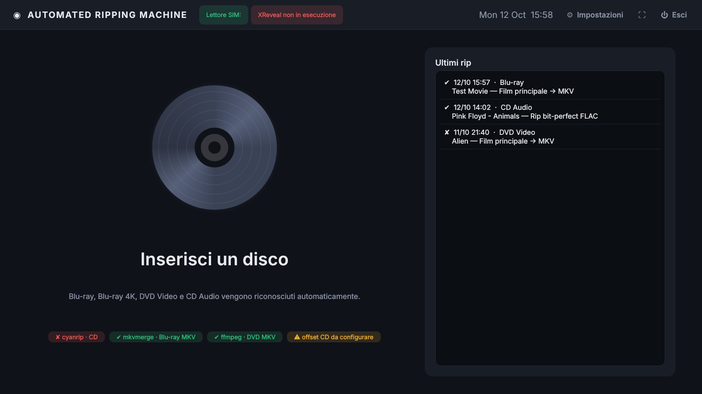
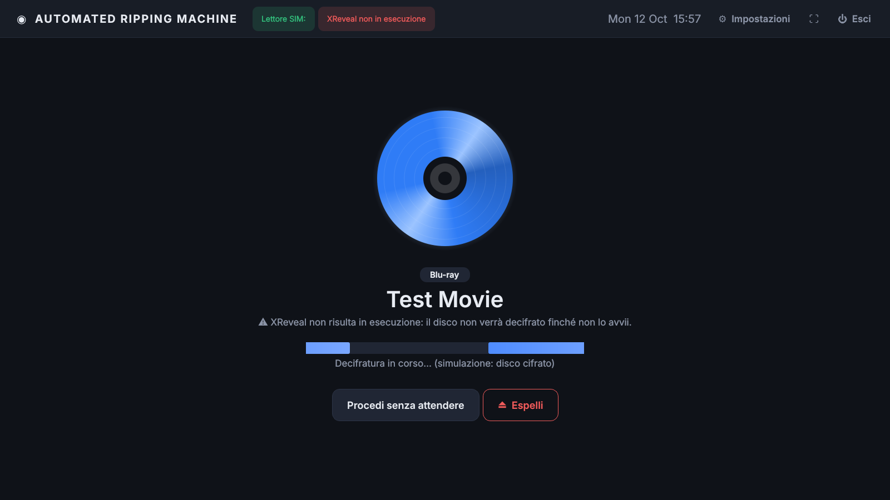
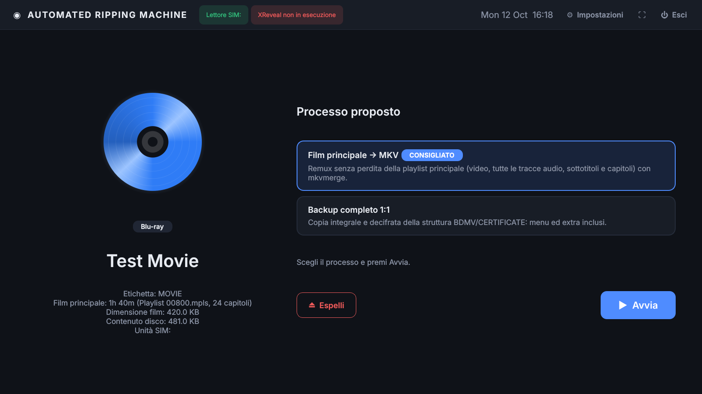

# Automated Ripping Machine (Windows · Qt)

App **a schermo intero** in Qt (PySide6) che trasforma un PC Windows in una
macchina di ripping: riconoscimento e analisi sono automatici, ma **nessun rip parte
senza un comando dell'utente**.

1. **Inserisci il disco**: l'app lo rileva da sola (polling del lettore ottico).
2. **Riconosce il tipo di disco**: Blu-ray, Blu-ray 4K UHD, DVD Video, CD Audio o disco dati.
3. **Attende XReveal**: per i dischi video aspetta che XReveal abbia finito di
   decifrare, verificando il contenuto vero e proprio invece di affidarsi a un ritardo fisso.
4. **Propone il processo corretto** (preselezionato): il rip parte **solo quando premi Avvia**,
   dopo aver eventualmente scelto un altro processo.
5. **Esegue il rip**, mostra avanzamento e log. Al termine il disco resta nel lettore finché non premi
   **Espelli** (l'espulsione automatica si può attivare nelle impostazioni).

| Attesa disco | Attesa XReveal | Proposta del processo |
|---|---|---|
|  |  |  |

<sub>Screenshot generati in modalità simulazione (`ARM_SIM_DRIVE`).</sub>

## Processi disponibili

| Disco | Processo | Strumento | Note |
|---|---|---|---|
| Blu-ray / UHD | **Film principale → MKV** | `mkvmerge` (MKVToolNix) | Remux senza perdita della playlist principale: tutte le tracce audio, sottotitoli e capitoli |
| Blu-ray / UHD | **Backup completo 1:1** | interno | Copia integrale decifrata (BDMV, CERTIFICATE, menu, extra) |
| DVD Video | **Film principale → MKV** | `ffmpeg` ≥ 7 (demuxer `dvdvideo`) | Remux senza perdita del titolo principale con capitoli |
| DVD Video | **Backup completo 1:1** | interno | Copia integrale della cartella VIDEO_TS |
| CD Audio | **Rip bit-perfect FLAC** | `cyanrip` | cd-paranoia, offset di lettura, verifica **AccurateRip**, CUE + log con checksum, metadati MusicBrainz e copertina |
| CD Audio | **Rip bit-perfect WAV** | `cyanrip` | Come sopra ma WAV non compresso |
| Dati | **Copia dei file** | interno | Copia con verifica delle dimensioni |

Il processo predefinito per ogni tipo di disco si sceglie nelle impostazioni.
Il film principale viene individuato automaticamente: per i Blu-ray si analizzano
le playlist `.mpls` (scartando le playlist "esca" con clip ripetute usate come
protezione), per i DVD si leggono gli IFO e si sceglie il titolo più lungo.

### Perché cyanrip per i CD

[cyanrip](https://github.com/cyanreg/cyanrip) è un ripper a riga di comando
open source che offre le stesse garanzie della modalità sicura di EAC: rilettura
con cd-paranoia finché i dati sono coerenti, correzione dell'offset del lettore,
confronto di ogni traccia con il database AccurateRip, file lossless con CUE e log
con checksum. Essendo CLI si integra direttamente nell'app.

> **Importante per l'1:1:** imposta l'**offset di lettura** del tuo lettore
> (Impostazioni → CD Audio). Puoi trovarlo su
> [accuraterip.com/driveoffsets.htm](http://www.accuraterip.com/driveoffsets.htm)
> oppure usare il pulsante **Rileva offset** con un CD presente nel database AccurateRip.

## Come viene gestito XReveal

XReveal lavora in background a livello di driver: appena il disco viene inserito
lo analizza e poi lo rende leggibile in chiaro a tutte le applicazioni.
L'app quindi **non lancia XReveal** ma:

* controlla che il processo XReveal sia in esecuzione (indicatore in alto e avviso);
* dopo un'attesa iniziale, **legge campioni reali del disco** a intervalli regolari:
  * **DVD (CSS):** legge settori sparsi del VOB principale e controlla il campo
    `PES_scrambling_control` dei pacchetti MPEG-2 (diverso da zero = ancora cifrato;
    un errore di lettura = disco non ancora sbloccato);
  * **Blu-ray (AACS):** legge blocchi da 6144 byte del `.m2ts` più grande e verifica che
    ogni pacchetto da 192 byte contenga il sync byte `0x47` (in un blocco cifrato solo i
    primi 16 byte sono in chiaro);
* procede appena i dati risultano decifrati; se si supera il timeout mostra
  **Procedi comunque / Riprova / Espelli**. Puoi anche premere **Procedi senza attendere**.

Attesa iniziale, intervallo di controllo, timeout e nomi del processo XReveal sono configurabili.

## Requisiti

* Windows 10/11 x64
* [XReveal](https://www.videohelp.com/software/Xreveal) installato e in esecuzione
* Python 3.10+ (solo se non usi l'eseguibile compilato)
* Strumenti esterni (basta quelli dei processi che usi):
  * **cyanrip** – [release Windows](https://github.com/cyanreg/cyanrip/releases)
  * **MKVToolNix** (mkvmerge) – [mkvtoolnix.download](https://mkvtoolnix.download/)
  * **ffmpeg** ≥ 7.0 *full build* (con libdvdnav/libdvdread, es. build "full" di gyan.dev)

Gli eseguibili vengono cercati in quest'ordine: percorso indicato nelle impostazioni,
cartella `tools\` accanto al programma, `PATH`, cartelle di installazione standard
(`C:\Program Files\MKVToolNix\…`). La schermata iniziale mostra quali strumenti sono stati trovati.

## Installazione e avvio

```bat
git clone https://github.com/adri6412/automated-ripping-machine.git
cd automated-ripping-machine
start.bat
```

`start.bat` crea un ambiente virtuale, installa PySide6 e avvia l'app senza finestra console.
In alternativa:

```bat
pip install -r requirements.txt
python -m arm            :: aggiungi --windowed per non partire a schermo intero
```

**Eseguibile già pronto:** ad ogni *release* pubblicata su GitHub il workflow
`.github/workflows/release.yml` esegue i test, compila l'exe con PyInstaller su Windows e
allega alla release lo zip `AutoRipMachine-<tag>-win64.zip`. Può essere lanciato anche a mano
da *Actions → Build Windows exe → Run workflow* (lo zip resta come artifact del run).

Per compilarlo in locale: `build.bat` (PyInstaller) → `dist\AutoRipMachine\AutoRipMachine.exe`.
Puoi copiare `cyanrip.exe`, `ffmpeg.exe`, `mkvmerge.exe` in `tools\` per un pacchetto autonomo.

Per un vero chiosco: metti un collegamento a `start.bat` (o all'exe) in
`shell:startup` così l'app parte all'accensione.

### Scorciatoie

* **F11** – schermo intero / finestra
* **Ctrl+,** – impostazioni
* **Ctrl+Q** – esci

## Dove finiscono i file

| Tipo | Cartella predefinita |
|---|---|
| Film (MKV e backup) | `%USERPROFILE%\Videos\Rips\<Titolo>\` |
| Musica | `%USERPROFILE%\Music\Rips\<Album>\` (schema di cyanrip) |
| Dischi dati | `%USERPROFILE%\Documents\DiscBackups\` |

Configurazione, cronologia e log di ogni rip: `%APPDATA%\AutoRipMachine\`.

## Struttura del codice

```
arm/
  core/
    winapi.py      unità ottiche via Win32 (presenza disco, TOC, etichetta, espulsione)
    disc.py        riconoscimento del tipo di disco
    decryption.py  verifica della decifratura XReveal (CSS / AACS)
    bluray.py      parser MPLS e scelta playlist principale
    dvd.py         parser IFO e scelta titolo principale
    processes.py   catalogo processi e proposta automatica
    monitor.py     thread di polling del lettore e di analisi/attesa
    config.py      configurazione JSON e ricerca degli strumenti
  jobs/            job di rip (copia 1:1, mkvmerge, ffmpeg, cyanrip)
  ui/              interfaccia fullscreen (pagine, stile, impostazioni)
tests/             test unitari con dischi sintetici
```

## Sviluppo e test

I test non richiedono Windows né un lettore: usano strutture di disco sintetiche
(MPLS, IFO, settori VOB e unità AACS cifrate/in chiaro) e strumenti finti.

```bash
pip install -r requirements.txt
python -m unittest discover -s tests -t .
```

Per provare l'interfaccia senza lettore, simula un disco con una cartella:

```bash
ARM_SIM_DRIVE=/percorso/cartella_disco python -m arm --windowed
# cartella con BDMV/ o VIDEO_TS/  -> disco video
# file .audiocd contenente il numero di tracce -> CD audio
# ARM_SIM_DECRYPTED=0 simula un disco non ancora decifrato
```

## Note legali

Effettua copie solo di dischi di tua proprietà e nel rispetto delle leggi del tuo paese
sulla copia privata e sull'aggiramento delle protezioni.
