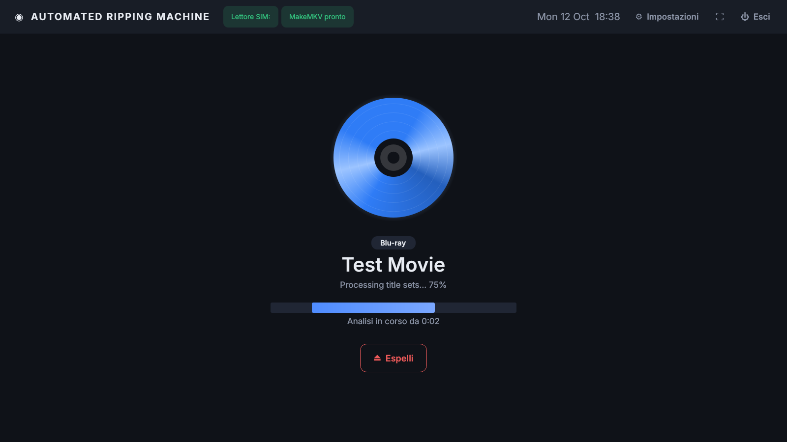

# Automated Ripping Machine (Windows · Qt)

App **a schermo intero** in Qt (PySide6) che trasforma un PC Windows in una
macchina di ripping: riconoscimento e analisi sono automatici, ma **nessun rip parte
senza un comando dell'utente**.

1. **Inserisci il disco**: l'app lo rileva da sola (polling del lettore ottico).
2. **Riconosce il tipo di disco**: Blu-ray, Blu-ray 4K UHD, DVD Video, CD Audio o disco dati.
3. **Analizza i dischi video con MakeMKV** (`makemkvcon info`, sola lettura): elenca i titoli
   e individua il film principale.
4. **Propone il processo corretto** (preselezionato): il rip parte **solo quando premi Avvia**,
   dopo aver eventualmente scelto un altro processo.
5. **Esegue il rip**, mostra avanzamento e log. Al termine il disco resta nel lettore finché non premi
   **Espelli** (l'espulsione automatica si può attivare nelle impostazioni).

| Attesa disco | Analisi MakeMKV | Proposta del processo |
|---|---|---|
|  |  |  |

<sub>Screenshot generati in modalità simulazione (`ARM_SIM_DRIVE` e un `makemkvcon` finto).</sub>

## Processi disponibili

| Disco | Processo | Strumento | Note |
|---|---|---|---|
| DVD / Blu-ray / UHD | **Film principale → MKV** | MakeMKV (`makemkvcon mkv`) | Decifra il disco e salva il titolo principale senza perdita: video, tutte le tracce audio, sottotitoli e capitoli |
| DVD / Blu-ray / UHD | **Tutti i titoli → MKV** | MakeMKV (`makemkvcon mkv … all`) | Tutti i titoli più lunghi della durata minima (extra, episodi) |
| Blu-ray / UHD | **Backup decifrato 1:1** | MakeMKV (`makemkvcon backup --decrypt`) | Copia integrale decifrata (BDMV, menu, extra) |
| CD Audio | **Rip bit-perfect FLAC** | `cyanrip` | cd-paranoia, offset di lettura, verifica **AccurateRip**, CUE + log con checksum, metadati MusicBrainz e copertina |
| CD Audio | **Rip bit-perfect WAV** | `cyanrip` | Come sopra ma WAV non compresso |
| Dati | **Copia dei file** | interno | Copia con verifica delle dimensioni |

Il processo predefinito per ogni tipo di disco si sceglie nelle impostazioni.
Il film principale è il titolo più lungo trovato da MakeMKV (a parità di durata vince
quello più grande, così le playlist "esca" dei Blu-ray protetti vengono scartate). Il file
del film principale viene rinominato con il titolo del disco.

## MakeMKV

[MakeMKV](https://www.makemkv.com/) legge e decifra da solo DVD (CSS), Blu-ray e 4K UHD
(AACS, BD+); l'app usa la sua versione a riga di comando `makemkvcon` in modalità
*robot* (`-r`), da cui ricava titoli, avanzamento e messaggi.

* **Chiave:** senza una licenza acquistata MakeMKV funziona con la **chiave beta gratuita**
  che lo sviluppatore pubblica (e rinnova ogni mese) sul
  [forum ufficiale](https://forum.makemkv.com/forum/viewtopic.php?t=1053). L'installer la
  imposta e l'app la **aggiorna da sola all'avvio** (disattivabile); se hai una licenza
  acquistata non viene mai toccata. In *Impostazioni → MakeMKV* puoi inserire la tua chiave o
  scaricare quella beta con un clic. La chiave si trova in `HKCU\Software\MakeMKV\app_Key`.
* Se la chiave è scaduta o la versione di MakeMKV è troppo vecchia, l'app lo segnala con un
  messaggio chiaro (aggiorna con "Aggiorna programmi esterni").
* **Durata minima dei titoli** (predefinita 120 s) e **cache di lettura** sono configurabili.
* Per i 4K UHD serve un lettore compatibile ("UHD friendly"): vedi la
  [lista sul forum MakeMKV](https://forum.makemkv.com/forum/viewforum.php?f=16).

### Perché cyanrip per i CD

[cyanrip](https://github.com/cyanreg/cyanrip) è un ripper a riga di comando
open source che offre le stesse garanzie della modalità sicura di EAC: rilettura
con cd-paranoia finché i dati sono coerenti, correzione dell'offset del lettore,
confronto di ogni traccia con il database AccurateRip, file lossless con CUE e log
con checksum. Essendo CLI si integra direttamente nell'app.

> **Importante per l'1:1:** imposta l'**offset di lettura** del tuo lettore
> (Impostazioni → CD Audio). Puoi trovarlo su
> [accuraterip.com/driveoffsets.htm](http://www.accuraterip.com/driveoffsets.htm)
> oppure usare il pulsante **Rileva offset** con un CD presente nel database AccurateRip.

## Requisiti

* Windows 10/11 x64
* Python 3.10+ (solo se usi i sorgenti invece dell'installer)
* Strumenti esterni (l'installer li scarica da solo; a mano basta installare quelli dei processi che usi):
  * **MakeMKV** – [makemkv.com](https://www.makemkv.com/download/) (DVD, Blu-ray, UHD)
  * **cyanrip** – [release Windows](https://github.com/cyanreg/cyanrip/releases) (CD audio)

Gli eseguibili vengono cercati in quest'ordine: percorso indicato nelle impostazioni,
cartella `tools\` accanto al programma (anche nelle sottocartelle create dall'installer), `PATH`, cartelle di installazione standard
(`C:\Program Files (x86)\MakeMKV\makemkvcon64.exe`, …). La schermata iniziale mostra quali strumenti sono stati trovati.

## Installazione e avvio

### Con l'installer (consigliato)

Scarica `AutoRipMachine-Setup-<versione>.exe` dalla pagina
[Releases](https://github.com/adri6412/automated-ripping-machine/releases) e avvialo.
L'installer:

* installa l'app (eseguibile già compilato: **non serve Python**);
* **scarica e installa i programmi esterni** (componenti selezionabili, tutti attivi nella
  installazione completa):

  | Programma | Fonte | Dove finisce |
  |---|---|---|
  | MakeMKV + chiave beta | winget (`GuinpinSoft.MakeMKV`) o installer ufficiale da makemkv.com; chiave dal forum ufficiale | installazione di sistema |
  | cyanrip | release ufficiali GitHub `cyanreg/cyanrip` | `<app>\tools\cyanrip\` |

* crea i collegamenti nel menu Start, compreso **"Aggiorna programmi esterni"**, che riscarica
  le ultime versioni (stesso script: `installer\install-deps.ps1`);
* opzionalmente avvia l'app all'accesso a Windows.

La disinstallazione rimuove anche la cartella `tools`; MakeMKV resta installato e si
rimuove dalle impostazioni di Windows. Se un download non riesce, l'installer completa
comunque l'installazione e mostra il riepilogo: puoi riprovare con "Aggiorna programmi esterni".

### Dai sorgenti

```bat
git clone https://github.com/adri6412/automated-ripping-machine.git
cd automated-ripping-machine
start.bat
```

`start.bat` crea un ambiente virtuale, installa PySide6 e avvia l'app senza finestra console.
MakeMKV (con la chiave beta) e cyanrip si possono installare con lo stesso script dell'installer:

```bat
powershell -ExecutionPolicy Bypass -File installer\install-deps.ps1 -InstallDir .
```

In alternativa: `pip install -r requirements.txt` e `python -m arm` (aggiungi `--windowed`
per non partire a schermo intero).

### Build e release automatiche

Ad ogni *release* pubblicata su GitHub il workflow `.github/workflows/release.yml`:

1. esegue i test su Windows;
2. compila l'exe con PyInstaller;
3. crea l'installer con Inno Setup;
4. prova davvero lo script di download dei programmi esterni;
5. allega alla release `AutoRipMachine-Setup-<versione>.exe` e lo zip portable
   `AutoRipMachine-<versione>-win64.zip`.

Si può lanciare anche a mano da *Actions → Build Windows exe → Run workflow* (i file restano
come artifact del run). In locale: `build.bat [versione]` crea l'exe e, se è installato
[Inno Setup 6](https://jrsoftware.org/isdl.php), anche l'installer.

### Scorciatoie

* **F11** – schermo intero / finestra
* **Ctrl+,** – impostazioni
* **Ctrl+Q** – esci

## Dove finiscono i file

| Tipo | Cartella predefinita |
|---|---|
| Film (MKV e backup) | `%USERPROFILE%\Videos\Rips\<Titolo>\` |
| Musica | `%USERPROFILE%\Music\Rips\<Album>\` (schema di cyanrip) |
| Dischi dati | `%USERPROFILE%\Documents\DiscBackups\` |

Configurazione, cronologia e log di ogni rip: `%APPDATA%\AutoRipMachine\`.

## Struttura del codice

```
arm/
  core/
    winapi.py      unità ottiche via Win32 (presenza disco, TOC, etichetta, espulsione)
    disc.py        riconoscimento del tipo di disco
    makemkv.py     makemkvcon: output robot, lettori, titoli, chiave beta
    bluray.py      titolo del disco e riconoscimento UHD
    processes.py   catalogo processi e proposta automatica
    monitor.py     thread di polling del lettore e di analisi del disco
    config.py      configurazione JSON e ricerca degli strumenti
  jobs/            job di rip (MakeMKV, cyanrip, copia file)
  ui/              interfaccia fullscreen (pagine, stile, impostazioni)
tests/             test unitari con dischi sintetici
```

## Sviluppo e test

I test non richiedono Windows né un lettore: usano strutture di disco sintetiche
e versioni finte di `makemkvcon` e `cyanrip` che producono lo stesso output dei programmi veri.

```bash
pip install -r requirements.txt
python -m unittest discover -s tests -t .
```

Per provare l'interfaccia senza lettore, simula un disco con una cartella:

```bash
ARM_SIM_DRIVE=/percorso/cartella_disco python -m arm --windowed
# cartella con BDMV/ o VIDEO_TS/  -> disco video
# file .audiocd contenente il numero di tracce -> CD audio
```

Per i dischi video serve anche un `makemkvcon`: su Linux/macOS puoi usare quello finto dei test
(`tests/fixtures.py`, funzione `fake_makemkvcon`) indicandone il percorso in
*Impostazioni → Programmi*.

## Note legali

Effettua copie solo di dischi di tua proprietà e nel rispetto delle leggi del tuo paese
sulla copia privata e sull'aggiramento delle protezioni.
